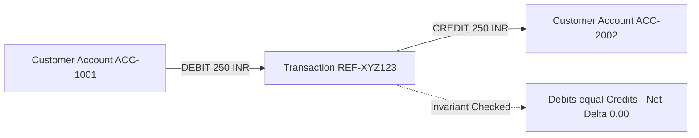
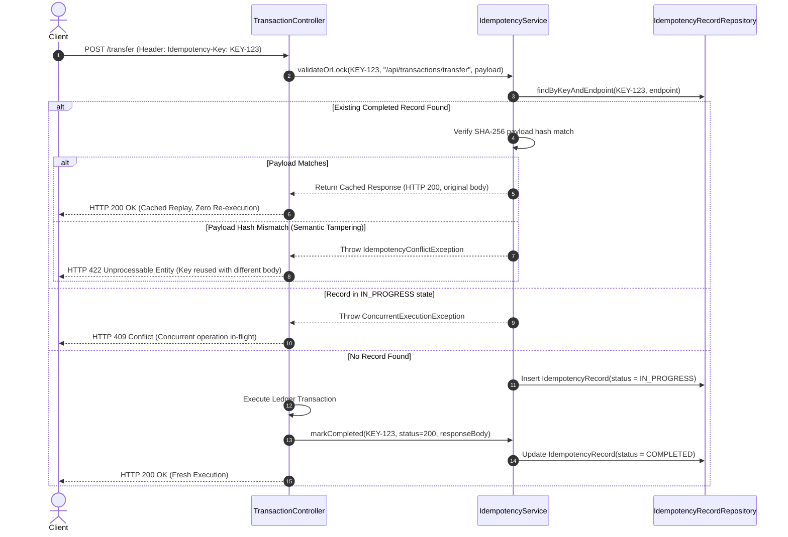
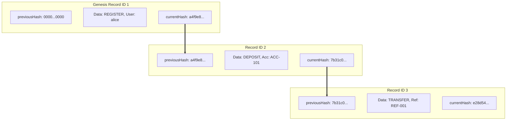
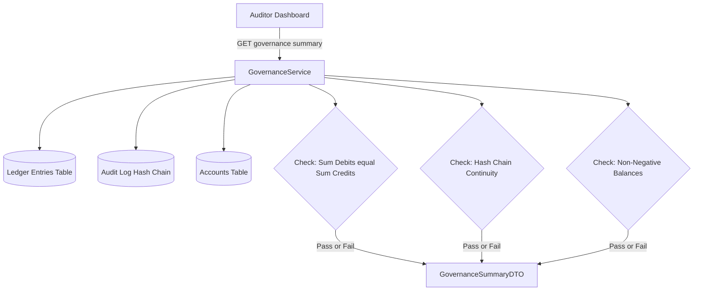

# LedgerLine: Architectural & Engineering Solutions
## Safe Financial Ledger Platform — Hiring Challenge Deep Dive

This document provides in-depth technical answers, formal proofs, architectural diagrams, and concrete implementation analyses for the six core engineering problems addressed by the **LedgerLine** platform.

---

### Table of Contents
1. [Strict Double-Entry Bookkeeping & Balance Conservation](#1-strict-double-entry-bookkeeping--balance-conservation)
2. [Concurrency Control & Race Condition Elimination](#2-concurrency-control--race-condition-elimination)
3. [Distributed Idempotency & Fault-Tolerant Retries](#3-distributed-idempotency--fault-tolerant-retries)
4. [Cryptographic Tamper-Evident Audit Trails (Hash Chaining)](#4-cryptographic-tamper-evident-audit-trails-hash-chaining)
5. [Deadlock Prevention via Deterministic Lock Ordering](#5-deadlock-prevention-via-deterministic-lock-ordering)
6. [Real-Time Regulatory Governance & Invariant Validation](#6-real-time-regulatory-governance--invariant-validation)

---

### 1. Strict Double-Entry Bookkeeping & Balance Conservation

#### The Problem: Why Naive Updates Fail
In naive banking systems, moving money is implemented via primitive direct updates:
```sql
-- DANGEROUS: Naive single-column update
UPDATE accounts SET balance = balance - 100 WHERE account_number = 'ACC-001';
UPDATE accounts SET balance = balance + 100 WHERE account_number = 'ACC-002';
```
If the database crashes, the connection drops, or a thread terminates between the first and second statement, money disappears or is created from thin air. Furthermore, mutating balance columns directly destroys financial history: there is no immutable audit trail of *why*, *when*, or *under what authority* the balance changed.

#### The LedgerLine Solution
LedgerLine implements **strict double-entry bookkeeping** governed by the fundamental accounting invariant:

$$\sum_{i=1}^{k} \text{Debits}_i - \sum_{i=1}^{k} \text{Credits}_i = 0$$

Every money movement is represented by a parent `Transaction` and at least two immutable child `LedgerEntry` records:
1. **DEBIT**: An entry recording funds leaving a source or entering an asset account.
2. **CREDIT**: An offsetting entry of identical magnitude recording funds entering a destination or balancing equity.



#### System Clearing Accounts for External Inflows/Outflows
In real-world finance, deposits and withdrawals involve external rails (e.g., ACH, Fedwire, SWIFT, physical cash). To maintain the zero-sum invariant across the entire system without creating synthetic money, LedgerLine introduces **System Clearing Accounts**:
- `SYS-CLEARING-USD`: External Cash Clearing Reserve.
- `SYS-FEES-USD`: Platform Revenue Clearing.

When a customer deposits \$500.00:
1. `SYS-CLEARING-USD` is **DEBITED** for \$500.00 (representing external cash deposited into the institution's reserve).
2. Customer Account `ACC-XXXX` is **CREDITED** for \$500.00.
3. System Invariant: $\text{Debits } (\$500.00) - \text{Credits } (\$500.00) = \$0.00$.

When a customer withdraws \$200.00:
1. Customer Account `ACC-XXXX` is **DEBITED** for \$200.00.
2. `SYS-CLEARING-USD` is **CREDITED** for \$200.00.
3. System Invariant: $\text{Debits } (\$200.00) - \text{Credits } (\$200.00) = \$0.00$.

**Code Reference**: `com.snovasys.ledgerline.service.TransactionService#recordDoubleEntry()`

---

### 2. Concurrency Control & Race Condition Elimination

#### The Problem: Double-Spend / Simultaneous Overdraft
Consider an account with a balance of \$100.00. Two concurrent requests arrive simultaneously (Thread A: withdraw \$80.00; Thread B: withdraw \$80.00).

```
Time | Thread A (Withdraw $80)         | Thread B (Withdraw $80)
-----+----------------------------------+----------------------------------
t1   | Read balance: $100.00            | Read balance: $100.00
t2   | Validates $100 >= $80 (OK)       | Validates $100 >= $80 (OK)
t3   | Writes new balance: $20.00       | 
t4   |                                  | Overwrites balance: $20.00
Result: Account was debited $160.00, but recorded balance is $20.00. Deficit: -$60.00!
```

#### Why Optimistic Locking (@Version) is Insufficient for High Contention
Optimistic locking detects concurrent writes by checking an entity version column (`WHERE id = ? AND version = ?`). When collision occurs, the database throws `OptimisticLockException`. While appropriate for low-contention CRUD apps, in financial platforms (e.g., flash sales, payroll processing, high-volume merchant wallets), optimistic locking causes:
1. High rollback rates and wasted compute.
2. Unpredictable client experience (sporadic 409 Conflict errors requiring client-side retry storms).
3. Risk of exhausting thread pools under contention.

#### The LedgerLine Solution: Pessimistic Write Locking (`SELECT ... FOR UPDATE`)
LedgerLine enforces database-level exclusive row locks using JPA's `LockModeType.PESSIMISTIC_WRITE`:

```java
// AccountRepository.java
@Lock(LockModeType.PESSIMISTIC_WRITE)
@Query("SELECT a FROM Account a WHERE a.accountNumber = :accountNumber")
Optional<Account> findByAccountNumberWithLock(@Param("accountNumber") String accountNumber);
```

Under PostgreSQL, this generates:
```sql
SELECT * FROM accounts WHERE account_number = ? FOR UPDATE;
```

#### Lock Lifecycle & Guarantees:
1. **Mutual Exclusion**: When Thread A acquires the lock on `ACC-001`, Thread B blocks at the database level until Thread A commits or rolls back its transaction.
2. **Current Read Guarantee**: When Thread B unblocks and reads the balance, it reads the committed balance (\$20.00), correctly rejects the second withdrawal due to insufficient funds, and throws `InsufficientFundsException`.
3. **Transaction Boundary**: The lock is held strictly within the `@Transactional` boundary and released automatically upon `COMMIT` or `ROLLBACK`.

---

### 3. Distributed Idempotency & Fault-Tolerant Retries

#### The Problem: The Two-Generals Network Dilemma
In distributed microservices, network communication is inherently unreliable. A client sends a \$1,000.00 transfer request. The server successfully validates, locks accounts, records ledger entries, updates balances, and commits the transaction. However, right before the HTTP 200 response reaches the client, the network drops.

```
Client                        Network Gateway                   Ledger Service
  |                                 |                                 |
  |--- POST /api/transactions ----->|--- POST /api/transactions ----->|
  |    (Transfer $1,000.00)         |                                 | [COMMITTED]
  |                                 |                                 | Balance debited!
  |                                 |<-- HTTP 200 OK (Transfer Resp) -|
  |   x [CONNECTION TIMED OUT] x    |                                 |
  |                                 |                                 |
  | Client does not know if the transfer succeeded or failed.        |
  | Client automatically retries: POST /api/transactions             |
  | Result without idempotency: CUSTOMER CHARGED TWICE ($2,000.00)!   |
```

#### The LedgerLine Idempotency Engine
LedgerLine mandates the client-supplied HTTP header `Idempotency-Key: <UUID>` on all mutating endpoints (`/deposit`, `/withdraw`, `/transfer`).



#### Key Guarantees:
1. **Exact-Once Execution**: Even if a network retry fires 50 times, the ledger mutations occur exactly once.
2. **Payload Fingerprinting**: A SHA-256 hash of the request body is persisted. Reusing an existing idempotency key with different parameters (e.g., trying to sneak a \$5,000 transfer under an old key) is immediately rejected with HTTP 422.
3. **24-Hour Expiration**: Idempotency records maintain a 24-hour time-to-live (`createdAt`), balancing audit compliance with database indexing efficiency.

**Code Reference**: `com.snovasys.ledgerline.service.IdempotencyService`

---

### 4. Cryptographic Tamper-Evident Audit Trails (Hash Chaining)

#### The Problem: Internal Bad Actors & Database Tampering
Relational database rows can be secretly modified or deleted by someone with direct database access (rogue DBAs, compromised credentials, or SQL injection):
```sql
-- Rogue DBA modifying audit logs to cover tracks:
UPDATE audit_logs SET actor = 'system', details = 'Routine maintenance' WHERE id = 42;
```
Standard relational tables have no mathematical mechanism to detect historical record alteration or missing rows.

#### The LedgerLine Solution: Blockchain-Style Hash Chaining
LedgerLine links every audit entry in the `AuditLog` entity into an unbroken cryptographic chain. Each record computes its SHA-256 digest over both its own fields **and** the hash of the preceding record:

$$H_n = \text{SHA-256}\Big( H_{n-1} \parallel \text{action} \parallel \text{entity} \parallel \text{entityId} \parallel \text{actor} \parallel \text{details} \parallel \text{timestamp} \Big)$$

Where:
- $H_0 = \text{"0000000000000000000000000000000000000000000000000000000000000000"}$ (Genesis Block Anchor)
- $H_{n-1} = \text{previousHash}$
- $H_n = \text{currentHash}$



#### Tamper Detection Mechanics:
If an attacker alters a single character in Record 2:
1. Recomputing $\text{SHA-256}(\text{Record 2})$ yields a new hash $C_2' \ne C_2$.
2. In Record 3, $P_3$ still points to the old $C_2$. The invariant $P_3 == C_2'$ is violated.
3. Every downstream record in the chain immediately fails validation.

#### Governance Verification API:
The `/api/governance/verify-chain` endpoint traverses the chain in sequence $1 \dots N$, verifies:
1. `record.getPreviousHash().equals(expectedPreviousHash)`
2. `record.getCurrentHash().equals(recomputedHash)`

If any link is broken, it reports `chainValid: false`, identifying the exact `brokenRecordId`, corrupted fields, and timestamp of the compromise.

**Code Reference**: `com.snovasys.ledgerline.service.GovernanceService#verifyChainIntegrity()`

---

### 5. Deadlock Prevention via Deterministic Lock Ordering

#### The Problem: Circular Wait Deadlocks
In transfers between two accounts, the system must lock both the source account and the destination account. If two users initiate transfers to each other at the same microsecond:
- **Thread 1 (Alice -> Bob)**: Acquires lock on Alice's account; attempts to acquire lock on Bob's account.
- **Thread 2 (Bob -> Alice)**: Acquires lock on Bob's account; attempts to acquire lock on Alice's account.

```
Thread 1 holds [Alice Lock], requests [Bob Lock] ---> BLOCKED
Thread 2 holds [Bob Lock], requests [Alice Lock] ---> BLOCKED
Result: DEADLOCK (PostgreSQL deadlock detector terminates one transaction with error 40P01)
```

#### The LedgerLine Solution: Deterministic Lexicographical Lock Ordering
A deadlock requires four Coffman conditions:
1. Mutual Exclusion
2. Hold and Wait
3. No Preemption
4. **Circular Wait**

By eliminating the fourth condition (**Circular Wait**), deadlocks become mathematically impossible.

LedgerLine imposes a **Total Order** ($\mathcal{O}$) over all account numbers using lexicographical string comparison (`String.compareTo`):

```java
// TransactionService.java (transfer method)
String firstLockNumber;
String secondLockNumber;

if (sourceAccountNumber.compareTo(destinationAccountNumber) < 0) {
    firstLockNumber = sourceAccountNumber;
    secondLockNumber = destinationAccountNumber;
} else {
    firstLockNumber = destinationAccountNumber;
    secondLockNumber = sourceAccountNumber;
}

// Always acquire locks in strictly identical ascending order:
Account firstLocked = accountRepository.findByAccountNumberWithLock(firstLockNumber)
    .orElseThrow(...);
Account secondLocked = accountRepository.findByAccountNumberWithLock(secondLockNumber)
    .orElseThrow(...);

Account source = sourceAccountNumber.equals(firstLockNumber) ? firstLocked : secondLocked;
Account destination = destinationAccountNumber.equals(firstLockNumber) ? firstLocked : secondLocked;
```

#### Formal Proof of Deadlock Impossibility:
Let $A$ and $B$ be two distinct accounts with $A <_{\text{lex}} B$.
- Any thread transferring from $A \to B$ locks $A$ first, then $B$.
- Any thread transferring from $B \to A$ locks $A$ first, then $B$.

Since every concurrent thread must acquire locks in the strict sequence $A \to B$, Thread 2 cannot acquire the lock on $B$ before acquiring $A$. It will queue behind Thread 1 on the lock for $A$. The resource allocation graph is a Directed Acyclic Graph (DAG) with no possible directed cycles. Deadlock probability is **0%**.

---

### 6. Real-Time Regulatory Governance & Invariant Validation

#### The Challenge: Automated Audit Compliance
Traditional banking systems perform reconciliation through nightly batch processing. In modern 24/7 financial ledgers, regulatory compliance (Basel III, Sarbanes-Oxley, FinCEN) requires real-time automated verification of system solvency and transaction balance.

#### LedgerLine Governance Architecture
LedgerLine provides dedicated, role-guarded endpoints accessible only by users with the `ROLE_AUDITOR` or `ROLE_ADMIN` authority.



#### Real-Time Invariant Checks:
1. **Global Ledger Balance Invariant**:
   $$\Delta_{\text{ledger}} = \sum_{e \in \text{LedgerEntries}} \text{DebitAmount}(e) - \sum_{e \in \text{LedgerEntries}} \text{CreditAmount}(e) \equiv 0$$
   Validated by `GovernanceService.verifyLedgerIntegrity()`. Any discrepancy indicates data corruption or balance fabrication.

2. **Tamper-Evident Hash Chain Continuity**:
   Traverses all audit log records from genesis to tip, verifying mathematical continuity. Returns whether the audit trail has been modified.

3. **Active Account Solvency**:
   Inspects all customer accounts to verify no account has violated non-negative balance constraints ($balance \ge 0$).

4. **Zero-Trust Role Segregation**:
   - `ROLE_ACCOUNT_HOLDER`: Can only transact on their own accounts; cannot view other accounts or audit trails.
   - `ROLE_AUDITOR`: Read-only access to governance summaries, audit logs, and integrity proofs; prohibited from initiating financial transactions.
   - `ROLE_ADMIN`: Administrative system provisioning and user lifecycle management.

**Code Reference**: `com.snovasys.ledgerline.controller.GovernanceController`

---

### Summary of System Guarantees

| Invariant / Threat | Architectural Mechanism | Enforcement Layer | Failure State Handled |
| :--- | :--- | :--- | :--- |
| **Balance Conservation** | Double-entry bookkeeping + System clearing accounts | `TransactionService` | Unbalanced transaction rejected at commit |
| **Double Spending** | `SELECT ... FOR UPDATE` Pessimistic Locking | PostgreSQL row lock | Overdraft rejected via `InsufficientFundsException` |
| **Network Duplication** | Idempotency engine + SHA-256 payload fingerprinting | `IdempotencyService` | Returns cached response; rejects payload tampering (422) |
| **Database Tampering** | Cryptographic SHA-256 blockchain hash chaining | `AuditLog` + `GovernanceService` | Broken link pinpointed by verification API |
| **Transfer Deadlocks** | Deterministic lexicographical lock acquisition order | `TransactionService.transfer()` | Circular wait eliminated; 0% deadlock rate |
| **Regulatory Solvency** | Real-time zero-sum reconciliation API | `GovernanceController` | Automated alerts on any mathematical delta |

