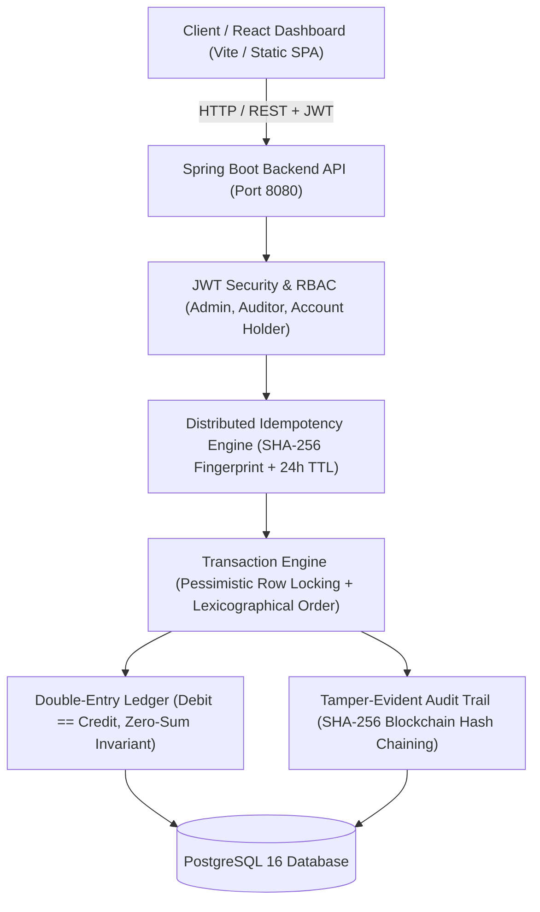

# LedgerLine - Safe Financial Ledger Platform

> **Hiring Challenge**: Solving unsafe money movement in financial applications with double-entry accounting, strict balance conservation, concurrency-safe locking, idempotency protection, tamper-evident audit trails, and an interactive React dashboard.

---

## 5-Day Development Roadmap

| Day | Focus Area | Status | Deliverables |
|:---:|:---|:---:|:---|
| **Day 1** | **Foundation, Security Architecture & User/Role Management (RBAC)** | **COMPLETED** | Spring Boot 4 / Java 21, SecurityFilterChain, JWT Authentication, Custom UserDetails, Roles (`ROLE_ADMIN`, `ROLE_ACCOUNT_HOLDER`, `ROLE_AUDITOR`), Auth Endpoints (`/register`, `/login`, `/me`, `/admin/users`), Health check (`/api/health`), Seed Users, Automated Auth Tests. |
| **Day 2** | **Account Domain, Double-Entry Ledger Core & Strict Balance Conservation** | **COMPLETED** | Account entity, Double-Entry Ledger entries (`Debit` = `Credit`), System Clearing Accounts (`SYS-CLEARING-001`), Zero-sum money movement invariant, Non-negative balance server checks, Statement API. |
| **Day 3** | **Concurrency Control, Simultaneous Withdrawal Safety & Idempotency Engine** | **COMPLETED** | Pessimistic Locking (`SELECT ... FOR UPDATE`), Deadlock-free ordered lock acquisition, Race condition elimination under high concurrent load, `Idempotency-Key` header & SHA-256 replay cache, Deposit / Withdraw / Transfer APIs. |
| **Day 4** | **Append-Only Immutable Audit Trail & Regulatory Governance APIs** | **COMPLETED** | Cryptographic tamper-evident Audit Log entity (blockchain-style SHA-256 hash chaining), Actor tracking, IP & User-Agent capture, Automated audit events on all mutations, Auditor inspection endpoints, Real-time ledger balance conservation verification ($\sum \text{Debits} - \sum \text{Credits} = 0$), Audit chain validation API, 32/32 Automated Tests Passing. |
| **Day 5** | **React Dashboard Integration, Dockerization, Hiring Challenge Answers & Packaging** | **COMPLETED** | Embedded & standalone React 18 SPA UI with Tailwind CSS, Quick-Role switcher, Live balance cards, Deposit/Withdraw/Transfer modals with Idempotency replay testing, Double-entry statement viewer, Cryptographic hash chain inspector, Multi-stage Dockerfiles & Docker Compose, Comprehensive `HIRING_QUESTIONS.md`. |

---

## Architecture Overview



---

## Repository Structure

LedgerLine is organized into clean, modular directories for backend, frontend, and database:

```
LedgerLine/
├── backend/                  # Java 21 / Spring Boot 4 REST API
│   ├── src/                  # Domain entities, services, controllers, security, tests
│   ├── pom.xml               # Maven configuration & dependencies
│   ├── mvnw / mvnw.cmd       # Maven Wrapper binaries
│   ├── Dockerfile            # Eclipse Temurin Java 21 multi-stage build
│   └── README.md             # Backend instructions & quickstart
├── frontend/                 # React 18 / Vite / Tailwind CSS Dashboard
│   ├── src/                  # Single-Page Application components & styles
│   ├── package.json          # Node dependencies & Vite build scripts
│   ├── Dockerfile            # Multi-stage Node build + Nginx Alpine
│   ├── nginx.conf            # Production reverse proxy to backend:8080
│   └── README.md             # Frontend dev server & build guide
├── database/                 # PostgreSQL Infrastructure
│   ├── init.sql              # Production DDL schema, constraints, indexes & seed data
│   └── README.md             # Relational ER diagrams & schema documentation
├── docker-compose.yml        # 1-command orchestration for Postgres, Backend, and Frontend
├── HIRING_QUESTIONS.md       # In-depth architectural proofs & technical challenge answers
└── README.md                 # Complete project overview & roadmap
```

---

## Hiring Challenge Deep Dive

Detailed architectural solutions, formal proofs, and code analyses for the six challenge problems are documented in [**`HIRING_QUESTIONS.md`**](file:///d:/LedgerLine/HIRING_QUESTIONS.md):

1. **Strict Double-Entry Bookkeeping & Balance Conservation**: Mathematical balance invariant ($\sum \text{Debits} - \sum \text{Credits} = 0$) and System Clearing Account mechanics.
2. **Concurrency Control & Race Condition Elimination**: Pessimistic write locking (`SELECT ... FOR UPDATE`), preventing double-spend and simultaneous overdrafts.
3. **Distributed Idempotency Engine**: `Idempotency-Key` header interception, SHA-256 payload fingerprinting, 24-hour replay caching, and duplicate request safety.
4. **Cryptographic Tamper-Evident Audit Trail**: Blockchain-style SHA-256 hash chaining with automated tamper detection and proof traversal.
5. **Deadlock Prevention in Multi-Party Transfers**: Mathematical proof of total ordering via deterministic lexicographical lock ordering (`A < B`).
6. **Real-Time Regulatory Governance**: Real-time solvency checks, zero-sum reconciliation APIs, and auditor role segregation.

---

## Day 5: React Dashboard & UI Features

The application includes an interactive **React 18 Single-Page Application (SPA)** that works both out-of-the-box embedded in Spring Boot (`/index.html`) and as a standalone Vite + React development project (`/frontend`):

- **Quick-Role Switcher**: Switch instantaneously between `ROLE_ADMIN` (`admin`), `ROLE_ACCOUNT_HOLDER` (`john_doe`), and `ROLE_AUDITOR` (`auditor`) with single-click authentication.
- **Live Account Balances**: Real-time balance cards with account types (`SAVINGS`, `CHECKING`, `SYSTEM`).
- **Interactive Financial Operations**:
  - **Deposit**: Move money from institutional clearing reserves into customer accounts.
  - **Withdrawal**: Disallow overdrafts with instant server-enforced validation.
  - **Transfer**: Inter-account transfers with real-time debit and credit feedback.
  - **Idempotency Testing Toggle**: Generates a persistent UUID key to test instant cache replays vs new executions.
- **Double-Entry Statement Inspector**: Live tabular view of immutable ledger entries showing Debit (`SYS-CLEARING` or Source) and Credit (`User` or Destination) legs.
- **Cryptographic Hash Chain Inspector**: Visualizes the tamper-evident SHA-256 audit log blockchain with unbroken link indicators and Genesis block anchor.
- **Regulatory Governance Dashboard**: Executive metric cards showing system solvency, total deposit/withdrawal volumes, and zero-sum conservation status ($\Delta = \$0.00$).

---

## Default Seed Credentials & Accounts

| Username | Password | Role | Account Number | Account Name | Initial Balance |
|:---|:---|:---|:---|:---|:---|
| `admin` | `Admin@123` | `ROLE_ADMIN` | `SYS-CLEARING-001` | System Clearing Account | `0.00 INR` |
| `auditor` | `Auditor@123` | `ROLE_AUDITOR` | — | Compliance Officer | — |
| `john_doe` | `User@123` | `ROLE_ACCOUNT_HOLDER` | `LL1000000001` | John's Savings Account | `0.00 INR` |
| `jane_smith` | `User@123` | `ROLE_ACCOUNT_HOLDER` | `LL1000000002` | Jane's Savings Account | `0.00 INR` |

---

## API Reference

### Authentication & User Management (Day 1)
| Method | Endpoint | Access | Description |
|:---|:---|:---|:---|
| `GET` | `/api/health` | Public | System and database health status |
| `POST` | `/api/auth/register` | Public | Register new user account |
| `POST` | `/api/auth/login` | Public | Authenticate credentials & return JWT |
| `GET` | `/api/auth/me` | Authenticated | Retrieve current user profile |
| `GET` | `/api/auth/admin/users` | `ROLE_ADMIN` | List all registered users |

### Account Management (Day 2)
| Method | Endpoint | Access | Description |
|:---|:---|:---|:---|
| `POST` | `/api/accounts` | `ROLE_ADMIN` | Create a new financial account for a user |
| `GET` | `/api/accounts/me` | `ROLE_ACCOUNT_HOLDER` | Retrieve accounts belonging to authenticated user |
| `GET` | `/api/accounts/{accountNumber}` | Authenticated | Retrieve specific account details |

### Financial Transactions & Concurrency Safety (Day 3)
| Method | Endpoint | Headers | Access | Description |
|:---|:---|:---|:---|:---|
| `POST` | `/api/transactions/deposit` | `Idempotency-Key` (opt) | `ACCOUNT_HOLDER`, `ADMIN` | Deposit money from system clearing account to user account |
| `POST` | `/api/transactions/withdraw` | `Idempotency-Key` (opt) | `ACCOUNT_HOLDER`, `ADMIN` | Withdraw money with non-negative balance check |
| `POST` | `/api/transactions/transfer` | `Idempotency-Key` (opt) | `ACCOUNT_HOLDER`, `ADMIN` | Deadlock-free account-to-account transfer |
| `GET` | `/api/transactions/{referenceId}` | Authenticated | Retrieve transaction and double-entry ledger lines |
| `GET` | `/api/transactions/account/{accountNumber}` | Authenticated | Paginated transaction history for an account |
| `GET` | `/api/transactions/statement/{accountNumber}` | Authenticated | Paginated double-entry statement (audit entries) |

### Regulatory Governance & Cryptographic Audit Trail (Day 4)
| Method | Endpoint | Access | Description |
|:---|:---|:---|:---|
| `GET` | `/api/governance/audit-logs` | `ROLE_AUDITOR`, `ROLE_ADMIN` | Paginated search of audit logs (filters: actor, action, entityType) |
| `GET` | `/api/governance/audit-logs/{id}` | `ROLE_AUDITOR`, `ROLE_ADMIN` | Retrieve single audit log with cryptographic hash proof |
| `GET` | `/api/governance/verify-chain` | `ROLE_AUDITOR`, `ROLE_ADMIN` | Verify cryptographic hash chain integrity across all audit records |
| `GET` | `/api/governance/verify-ledger` | `ROLE_AUDITOR`, `ROLE_ADMIN` | Real-time validation that $\sum \text{Debits} - \sum \text{Credits} = 0$ |
| `GET` | `/api/governance/summary` | `ROLE_AUDITOR`, `ROLE_ADMIN` | Executive compliance summary (volumes, accounts, integrity status) |

---

## Automated Test Suite

LedgerLine includes **32 automated tests** covering security, double-entry bookkeeping, pessimistic concurrency locking, idempotency replay, cryptographic hash verification, and dynamic tamper detection:

```powershell
cd backend
.\mvnw.cmd test
```

### Test Suite Summary (32/32 Passing)
- **`AuthControllerTest` (8 tests)**: Registration, JWT login, authentication failure, role escalation blocking, profile retrieval.
- **`TransactionControllerTest` (13 tests)**: Deposits, withdrawals, overdraft rejection (422), inter-account transfers, self-transfer blocking, double-entry balance validation, and idempotency key replay caching.
- **`GovernanceControllerTest` (10 tests)**: Audit log search, single record hash proof, ledger zero-sum verification, governance summary metrics, RBAC boundary enforcement, and **dynamic database tamper detection test** (deliberately corrupts an audit row and confirms verification flags the exact broken record ID).
- **`LedgerLineApplicationTests` (1 test)**: Spring context verification.

---

## Deployment & Running Options

### Option 1: One-Command Docker Compose (Production Ready)
Spin up PostgreSQL, the Spring Boot backend, and the Nginx-hosted React frontend in isolated containers:

```bash
docker compose up --build
```

- **React Web App**: `http://localhost:3000` (or `http://localhost:8080/index.html`)
- **Backend API**: `http://localhost:8080/api`
- **PostgreSQL**: `localhost:5432`

---

### Option 2: Local Development (Spring Boot + Embedded React SPA)

#### 1. Prerequisites
- **Java 21 (JDK 21)**
- Included Maven Wrapper (`.\mvnw.cmd`)

#### 2. Start Spring Boot Backend
Navigate to the `backend` folder and run:
```powershell
cd backend
.\mvnw.cmd spring-boot:run
```
*(Runs with default zero-setup in-memory database and pre-seeded users and accounts)*

#### 3. Open the Interactive Dashboard
Navigate directly to:
```
http://localhost:8080/index.html
```

---

### Option 3: Standalone React Frontend (Vite Dev Server)

If you wish to run the standalone frontend in hot-reloading development mode:

```bash
cd frontend
npm install
npm run dev
```

The frontend will run at `http://localhost:5173` and proxy requests to `http://localhost:8080`.
