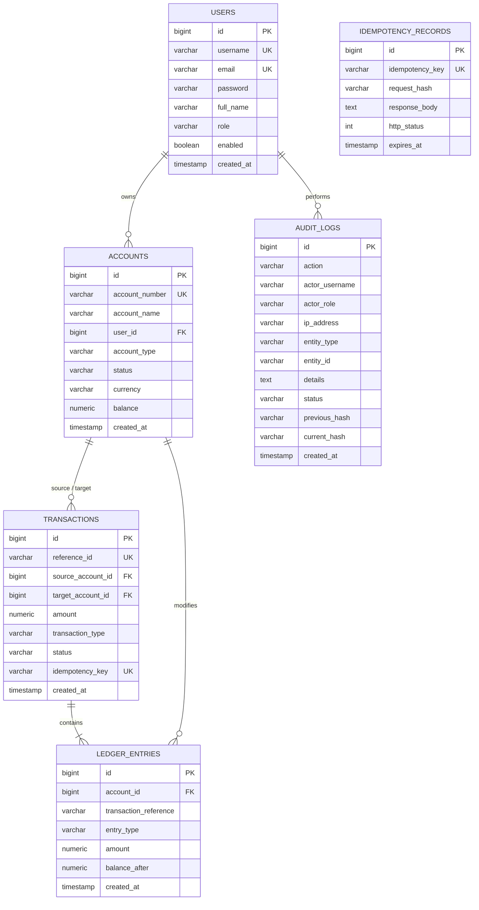

# LedgerLine: Database Architecture & Schema Documentation

This directory contains the database initialization scripts and relational architecture documentation for **LedgerLine**.

---

## 1. Directory Contents
- **`init.sql`**: Production-ready PostgreSQL DDL and seeding script. Automatically mounted in Docker Compose at `/docker-entrypoint-initdb.d/init.sql`.
- **`README.md`**: Complete schema reference and design principles.

---

## 2. Relational Schema Architecture



---

## 3. Core Database Invariants

1. **Double-Entry Balance Conservation**:
   Every transaction writes at least two rows to `ledger_entries`: one `DEBIT` and one `CREDIT`.
   $$\sum \text{Debits} - \sum \text{Credits} = 0$$

2. **Pessimistic Row-Level Locking**:
   The `accounts` table uses `SELECT ... FOR UPDATE` exclusively within `@Transactional` blocks to ensure mutual exclusion during simultaneous balance mutations.

3. **Blockchain Hash Chaining**:
   The `audit_logs` table forms a cryptographic chain where `current_hash` is computed as:
   $$H_n = \text{SHA-256}(H_{n-1} \parallel \text{action} \parallel \text{actor} \parallel \text{entityType} \parallel \text{entityId} \parallel \text{details} \parallel \text{status} \parallel \text{timestamp})$$

---

## 4. How to Connect / Initialize Locally

### Via Docker Compose
When running `docker compose up`, PostgreSQL initializes automatically from `init.sql`:
```bash
docker compose up postgres
```

### Manual PostgreSQL Connection
```bash
psql -U postgres -h localhost -p 5432 -d ledgerline_db -f init.sql
```

